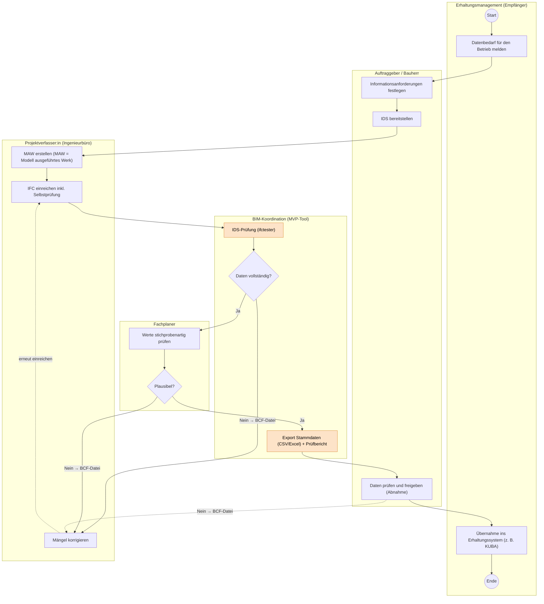

# Workflow

## MVP – Übergabe-Check Brücken: vom BIM-Projekt ins Erhaltungsmanagement

Ablauf der Datenübergabe von der Projektierung (BIM) in das Erhaltungsmanagement. Orange markierte Schritte sind automatisiert (MVP-Tool).

## Schritte

| Nr. | Rolle | Schritt |
| --- | --- | --- |
| 1 | Erhaltungsmanagement (Empfänger) | Datenbedarf für den Betrieb melden |
| 2 | Auftraggeber / Bauherr | Informationsanforderungen festlegen |
| 3 | Auftraggeber / Bauherr | IDS bereitstellen |
| 4 | Projektverfasser:in (Ingenieurbüro) | MAW erstellen (MAW = Modell ausgeführtes Werk) |
| 5 | Projektverfasser:in (Ingenieurbüro) | IFC einreichen inkl. Selbstprüfung |
| 6 | BIM-Koordination (MVP-Tool) | IDS-Prüfung (ifctester), automatisiert |
| 7 | BIM-Koordination (MVP-Tool) | Entscheid: Daten vollständig? Nein: BCF-Datei an Projektverfasser:in, Mängel korrigieren, erneut einreichen. Ja: weiter zu Schritt 8 |
| 8 | Fachplaner | Werte stichprobenartig prüfen |
| 9 | Fachplaner | Entscheid: plausibel? Nein: BCF-Datei an Projektverfasser:in, Mängel korrigieren, erneut einreichen. Ja: weiter zu Schritt 10 |
| 10 | BIM-Koordination (MVP-Tool) | Export Stammdaten (CSV/Excel) und Prüfbericht, automatisiert |
| 11 | Auftraggeber / Bauherr | Daten prüfen und freigeben (Abnahme). Bei Mängeln: BCF-Datei an Projektverfasser:in |
| 12 | Erhaltungsmanagement (Empfänger) | Übernahme ins Erhaltungssystem (z. B. KUBA) |

## Korrekturschleife

Bei jedem Entscheid mit „Nein“ (Vollständigkeit, Plausibilität, Abnahme) wird eine BCF-Datei erstellt. Die Projektverfasser:in korrigiert die Mängel und reicht das IFC erneut ein.
